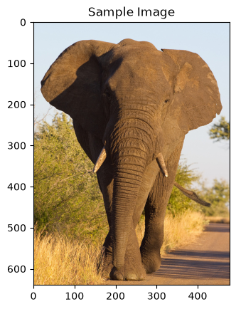
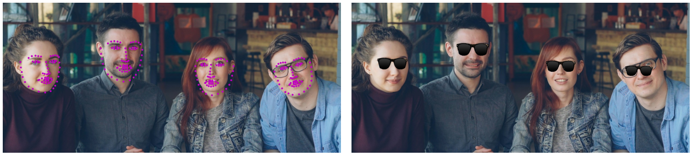
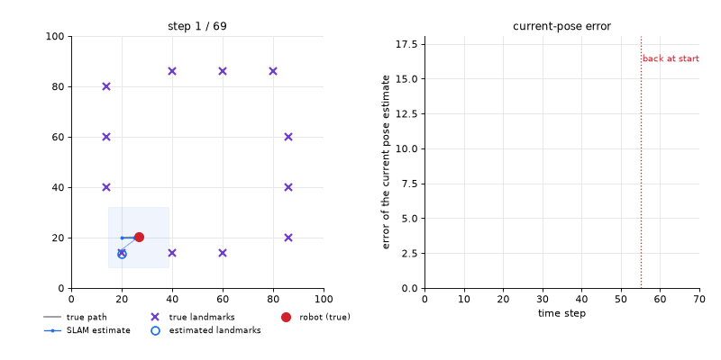

# Computer Vision Projects

Three computer vision projects that started as assignments in the Udacity Computer Vision Nanodegree. I later revisited and extended each one with my own evaluation, fixes and additions. Each project's README credits the course code it builds on and separates it from my own work.

| Project | Main technique | Stack | Status |
|---|---|---|---|
| [Image Captioning](image_captioning/) | CNN encoder + LSTM decoder (*Show and Tell*) | PyTorch, torchvision, MS COCO 2014 | Complete; weights on [GitHub release](https://github.com/igquinteroch/computer-vision-projects/releases/tag/image-captioning-v1.0) |
| [Facial Keypoint Detection](facial_keypoints_detection/) | CNN keypoint regression + Haar face detection | PyTorch, OpenCV, YouTube Faces | Complete; weights on [GitHub release](https://github.com/igquinteroch/computer-vision-projects/releases/tag/facial-keypoints-v1.0) |
| [Graph SLAM](graph_slam/) | Graph SLAM (information form) + online SLAM | NumPy, matplotlib, pytest | Complete;  |

## [Image Captioning](image_captioning/)

   
  <em>"a large elephant standing in a field next to a tree."</em>

A ResNet-18 encoder and an LSTM decoder that generate a one-sentence description of an image. The image embedding is fed to the LSTM as its first time step, and the caption is decoded greedily one word at a time. The model was trained on all 414k image–caption pairs in COCO train2014.

- Final training loss ≈ **2.0** (perplexity ≈ 7.5) after 3 epochs, about 3 h on an Apple M3 Pro.
- A frozen backbone and length-bucketed batches mean that only the projection and decoder are trained, with no padding.
- The README shows random, non-cherry-picked test samples, and analyzes where the captions fail: dataset priors ("swinging at a ball"), repetitions, and content shown on screens.

## [Facial Keypoint Detection](facial_keypoints_detection/)

   
  <em>Predicted keypoints (left) and sunglasses placed from them (right). Photo by <a href="https://unsplash.com/photos/four-friends-are-sitting-together-at-a-table-wAntJVFnMh8">Vitaly Gariev on Unsplash</a>.</em>

A CNN that predicts 68 facial landmarks on any face in a photo. Faces are found with an OpenCV Haar cascade, and the keypoints then drive a simple face filter. Revisiting the project turned up a preprocessing bug: the submitted model had learned to output the same average face for every image. I fixed it and retrained the model.

- On unseen people, the final model has a **5.2 px** mean error and **12.1 % NME**. The mean-shape baseline gets 32.4 %, and the submitted model 32.6 %.
- The final model is 8.5× smaller than the original (5.2 M vs. 44.5 M parameters).
- The crop margin of the detection pipeline is calibrated on the training data. Without it, the pipeline error almost doubles (18.3 % vs. 9.9 % NME on validation).

## [Graph SLAM](graph_slam/)

   
  <em>Loop closure. The current-pose error grows during the lap and drops when the robot sees the landmarks next to its start again.</em>

A robot that maps landmarks and localizes itself at the same time, from noisy odometry and noisy landmark measurements. All poses and landmarks are solved as one linear system. The project adds an online variant with constant memory, and an evaluation against ground truth on random and structured worlds.

- With noise 2, SLAM's pose RMSE is **1.06**, against 5.02 for dead reckoning, over 20 seeds. Errors scale linearly with noise, and SLAM stays 4–5× more accurate at every noise level.
- Online SLAM matches full SLAM to within 1e-11. At N = 2000 it uses 12 KB instead of 129 MB, and is 5.6× faster (49 ms vs. 274 ms).
- On a closed loop, closing the loop reduces the current-pose error from 5.86 to 2.83, averaged over 8 seeds.

## How to run

Each project is self-contained, with its own `requirements.txt`, Python 3.11 virtual environment (`.venv/` inside the project folder, created with `uv` or `venv`), and numbered notebooks. Setup, data and weights are explained in each project's README:

- [Image Captioning: how to run](image_captioning/README.md#how-to-run) (needs MS COCO 2014 and the released weights)
- [Facial Keypoint Detection: how to run](facial_keypoints_detection/README.md#how-to-run) (the dataset downloads automatically, plus the released weights)
- [Graph SLAM: how to run](graph_slam/README.md#how-to-run) (no data or weights; runs on CPU in seconds)

## Credits

The starter code, notebook skeletons and some data come from the Udacity Computer Vision Nanodegree. The *Credits* section of each project's README lists exactly which parts come from the course, which are my own work, and the papers and datasets used.
