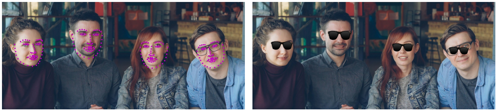
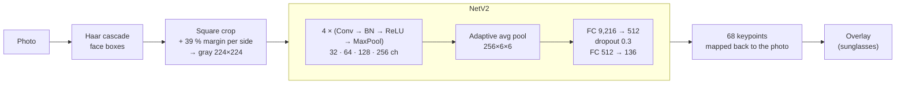
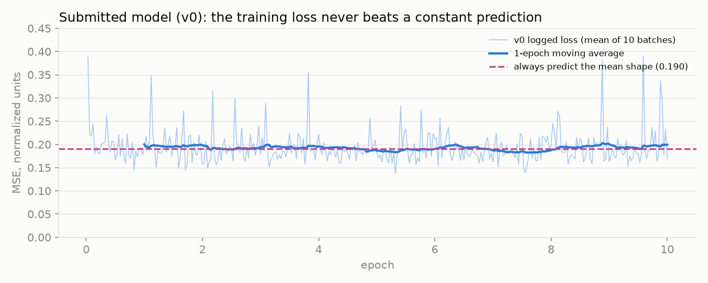
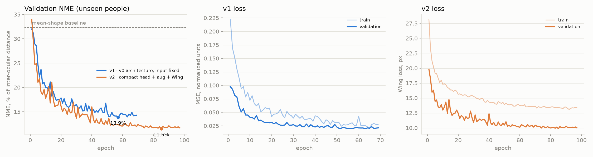
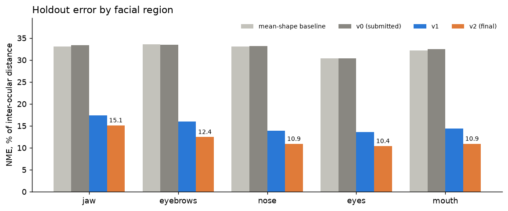
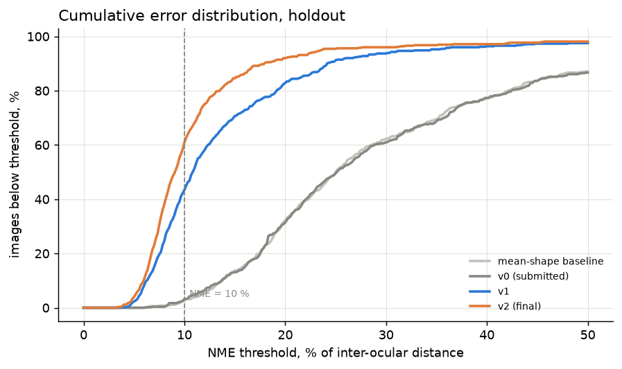
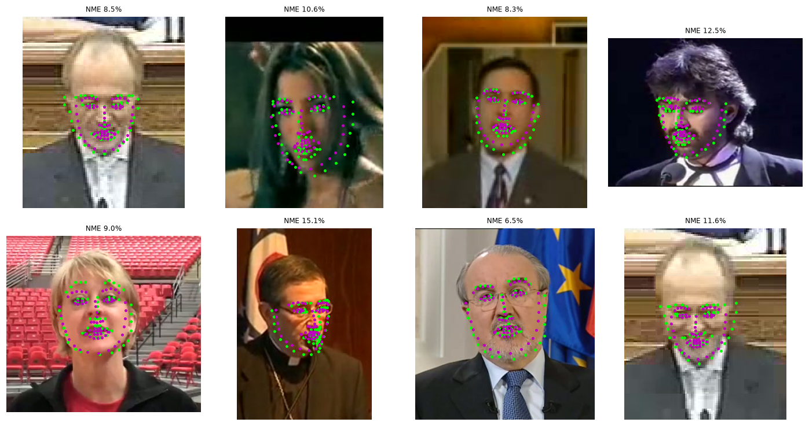
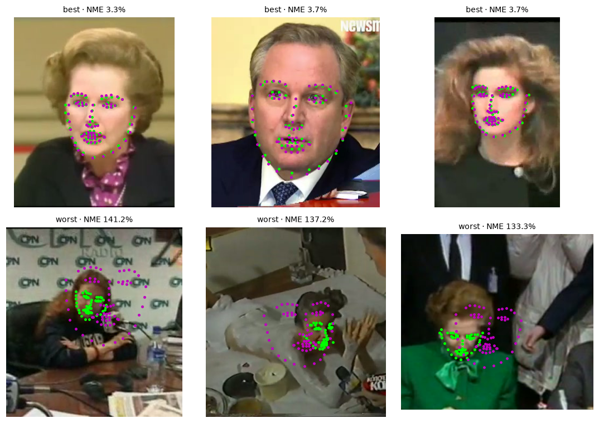
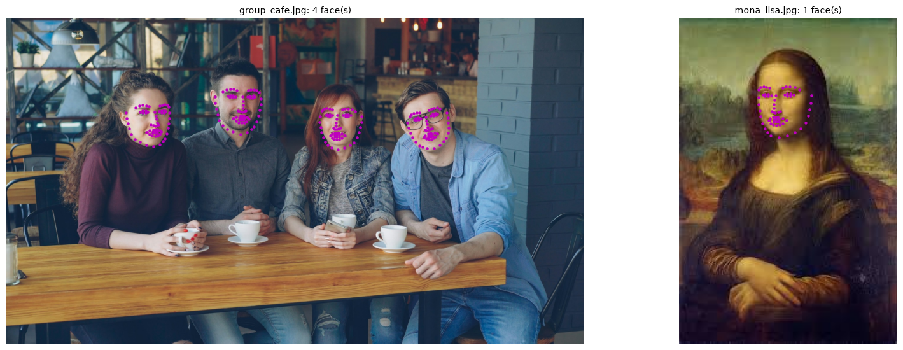

# Facial Keypoint Detection

A CNN that predicts 68 facial landmarks (jaw, eyebrows, nose, eyes and mouth) on any face in a photo. Faces are found with an OpenCV Haar cascade, and the keypoints then drive a simple face filter.

<p align="center">
  <br>
  <em>Predicted keypoints (left) and sunglasses placed from them (right). Every position comes from the model's predictions. Photo by <a href="https://unsplash.com/photos/four-friends-are-sitting-together-at-a-table-wAntJVFnMh8">Vitaly Gariev on Unsplash</a>.</em>
</p>

## Overview

The model regresses 136 numbers, an (x, y) pair for each of the 68 landmarks, from a 224×224 grayscale face crop. It was trained on ~3,500 annotated frames from the [YouTube Faces Dataset](https://www.cs.tau.ac.il/~wolf/ytfaces/).

This started as a Nanodegree project. Revisiting it turned up a preprocessing bug: the submitted model (**v0**) had learned to output the same average face for every image. After fixing the bug, I retrained the original architecture (**v1**) and then trained an improved model (**v2**). All of them were evaluated on people that no model had seen.

| | Final model (v2) |
|---|---|
| Network | 4 conv blocks (32/64/128/256 channels) with BatchNorm and max-pool, adaptive average pooling to 6×6, FC 9,216 → 512 → 136, dropout 0.3. 5.2 M parameters |
| Input / output | 224×224 grayscale crop in [0, 1] → 68 (x, y) keypoints |
| Training | Wing loss, Adam (lr 5e-4), batch 32, `ReduceLROnPlateau`, early stopping on validation NME. Best of 97 epochs |
| Augmentation | Horizontal flip with landmark relabeling, ±15° rotation, 0.9–1.1 scale, random 224 crop |
| Data split | By **person**: 70 % train / 15 % validation / 15 % holdout |
| Holdout result | **5.2 px** mean point error, **12.1 % NME** (median 9.0 %) |
| Hardware | Apple M3 Pro (MPS), ~19 min of training |

## Architecture



- **The crop margin is calibrated, not guessed.** Training images are loose crops, while a Haar box is tight around the face. The margin that turns one into the other is the median over the training images, 0.39 of the box per side. Without it the pipeline error doubles (18.3 % against 9.9 % NME on validation). See [`04_detection_pipeline`](notebooks/04_detection_pipeline.ipynb).
- **Flip augmentation relabels the landmarks.** After mirroring an image, the left eye corner (36) is where the right one (45) should be, so the 68 points are permuted (`config.FLIP_PERMUTATION`).
- **The splits are by person.** The official test set shares people *and video clips* with the training set, so the error on it is optimistic. Validation and holdout are made of unseen people instead.

The reasoning behind each choice is in the *Design decisions* section of [`02_training`](notebooks/02_training.ipynb).

## The bug in the submitted model

The dataset images are **PNG files with a `.jpg` extension**. The starter code read them with `matplotlib.image.imread`:

- Up to matplotlib 3.2, `imread` chose the reader from the file extension and returned these images as `uint8`.
- Since matplotlib 3.3 (2020), it detects the PNG content and returns floats in [0, 1].
- The `Normalize` transform then divided by 255 again.

The submitted model was therefore trained on nearly black images, in [0, 0.004], and it learned to ignore them and output the average face.



How it was found and confirmed:
1. **First quantitative check:** v0's error on its own training images equals that of the mean-shape baseline (13.5 px for both).
2. **Its predictions do not depend on the input:** they vary by ~0.001 px between images, against ~15 px for the ground truth.
3. **The original run shows the same thing:** the loss logged on the Udacity workspace stays at the MSE of a constant prediction (0.19) from the first epoch.
4. **The original filter notebook printed a telltale warning:** matplotlib's `[0..1] for floats` clipping warning, which only appears when images are read as floats.

It went unnoticed because `imshow` auto-scales the dark images, because the dataset's centered faces make the average face look plausible on any single example, and because there was no baseline to compare against. The fix is `data_load.read_rgb`, which always reads `uint8` RGB. The full story is in [`03_evaluation`](notebooks/03_evaluation.ipynb).

## Results

### Training



Both models were trained with the same schedule and selected by validation NME. Fixing the inputs is the largest single gain: **v1**, the submitted architecture and loss with correct inputs, drops from the baseline's 32 % NME to 14 %. **v2** combines three changes, so its gain cannot be attributed to any one of them (see *next steps*):
- a compact head with BatchNorm, which shrinks the model from 44.5 M to 5.2 M parameters and the weights file from 178 MB to 21 MB;
- flip, rotation and scale augmentation;
- Wing loss.

### Holdout (unseen people)

| Model | Mean error | NME | Median NME | Images with NME < 10 % | Params |
|---|---|---|---|---|---|
| Mean-shape baseline | 14.5 px | 32.4 % | 25.0 % | 3 % | – |
| v0 (submitted) | 14.6 px | 32.6 % | 25.1 % | 3 % | 44.5 M |
| v1 (inputs fixed) | 6.5 px | 15.2 % | 10.8 % | 43 % | 44.5 M |
| **v2 (final)** | **5.2 px** | **12.1 %** | **9.0 %** | **61 %** | **5.2 M** |

NME is the mean point error divided by the distance between the outer eye corners. The holdout was evaluated once, after v2 had been chosen on validation. Its NME is slightly worse than on validation (12.1 % against 11.5 %), and the number is reported as it came out.

| | |
|---|---|
|  |  |

**Official test set.** On the original test split, v2 scores 9.6 % NME. That figure is optimistic, because every test image is a neighboring frame of a training clip. Splitting the test set by person shows the gap. On people in its training subset v1 gets 9.5 %, and on holdout people 13.8 %. v2's gap is much smaller (9.3 % against 10.8 %), so it memorizes less and generalizes better.

**Why these numbers are not comparable with 300W or similar benchmarks.**
- The faces are small, low-resolution video frames: the median inter-ocular distance is ~44 px.
- The annotations come from a different source with its own conventions.
- The protocol differs: the faces are pre-cropped, and the normalization and splits are not the benchmark's.

The NME here is only meaningful for comparing models within this project.

### Random holdout samples (not cherry-picked)

Eight holdout images drawn with a fixed seed. Green is the ground truth, magenta is v2's prediction.



### Where it fails



- **Wide, off-center shots.** Five of the eight worst holdout images have a small face away from the center. The model predicts a normally sized face near the middle, because it has learned the dataset's typical framing. In the detection pipeline the crop comes from a face detector, which removes most of this failure mode: pipeline NME on validation is 9.9 %, against 11.5 % with the dataset's framing.
- **Strong head turns.** The predicted shape stays closer to frontal than the real pose, and the far side of the jaw is pulled inward.
- **Small faces** have a higher NME but a similar *pixel* error (~4.6 px). Dividing by a short inter-ocular distance inflates the normalized error.

The full analysis is in [`03_evaluation`](notebooks/03_evaluation.ipynb).

### On real photos



All four faces in the group photo are found and fitted. The two people who tilt their heads get shapes that follow the tilt only partially, the same frontal bias seen on the holdout. On this photo the Haar cascade also fires on the wall and on the hands, so it needs a minimum box size (`min_size=0.12`) to keep only the faces.

### Limitations and next steps

- **Ablation of v2.** Train with one change at a time (head, augmentation, loss) to measure what each contributes.
- **Rotate the filter with the head.** Align the sunglasses with the eye line (36 → 45) so they follow head roll. Today they are axis-aligned.
- **A better face detector.** The Haar cascade misses profile and tilted faces, and needs a minimum box size on large photos to avoid false positives.
- **Pose robustness.** Add stronger yaw augmentation, or move to heatmap regression, which handles large poses better than direct coordinate regression.
- **A larger and cleaner benchmark.** Evaluate on a dataset with a standard protocol to get numbers that are comparable with published work.

## Project structure

```
facial_keypoints_detection/
├── config.py            # paths, device (cuda → mps → cpu), splits, normalization, landmark regions
├── models.py            # Net (v0/v1), NetV2 (final), load_trained()
├── data_load.py         # dataset, transforms, augmentation, person-level split, read_rgb()
├── train.py             # training loop, Wing loss, run configs (python train.py v1|v2)
├── metrics.py           # point error, NME, region NME, CED, mean-shape baseline
├── pipeline.py          # Haar detection, padded crop, keypoint prediction, sunglasses overlay
├── notebooks/
│   ├── 01_data_exploration.ipynb
│   ├── 02_training.ipynb
│   ├── 03_evaluation.ipynb
│   ├── 04_detection_pipeline.ipynb
│   └── 05_face_filters.ipynb
├── logs/                # training logs of v0 (original run), v1 and v2
├── scripts/plot_loss.py # regenerates assets/loss_curve.png and assets/v0_loss_plateau.png
├── detector_architectures/  # OpenCV Haar cascades (the pipeline uses the frontal-face one)
├── images/              # group photo, Mona Lisa and the sunglasses overlay
└── assets/              # figures used in this README
```

## How to run

**1. Environment** (Python 3.11):

```bash
cd facial_keypoints_detection
uv venv --python 3.11 .venv && source .venv/bin/activate   # or: python -m venv .venv
uv pip install -r requirements.txt                          # or: pip install -r requirements.txt
```

OpenCV is pinned to 4.x: OpenCV 5 moved `CascadeClassifier` out of the main package.

**2. Pretrained weights.** Download them from the [GitHub release `facial-keypoints-v1.0`](https://github.com/igquinteroch/computer-vision-projects/releases/tag/facial-keypoints-v1.0) into `models/`:

```bash
mkdir -p models && cd models
BASE=https://github.com/igquinteroch/computer-vision-projects/releases/download/facial-keypoints-v1.0
for f in keypoints_cnn_v2.pt keypoints_cnn_v1.pt keypoints_cnn_v0.pt SHA256SUMS; do curl -L -O "$BASE/$f"; done
shasum -a 256 -c SHA256SUMS && cd ..
```

| File | Size | Used by |
|---|---|---|
| `keypoints_cnn_v2.pt` | 21 MB | final model: all notebooks |
| `keypoints_cnn_v1.pt` | 178 MB | comparisons in notebooks 02 and 03 |
| `keypoints_cnn_v0.pt` | 178 MB | comparisons in notebooks 02 and 03 |

v0 is the submitted model with the preprocessing bug: it predicts the same average face for every image. It is published only to reproduce the diagnosis, not for inference. For notebooks 04 and 05, v2 alone is enough.

**3. Data.** The dataset (~340 MB) is downloaded into `data/` the first time `data_load.download_data()` runs (notebook 01 calls it). To keep it somewhere else, set `FKD_DATA_ROOT`.

**4. Notebooks.** Run them from the `notebooks/` directory:

| Notebook | What it does | Needs |
|---|---|---|
| `01_data_exploration` | Dataset structure, the train/test overlap, the PNG/`imread` issue, transforms | data |
| `02_training` | Design decisions, training curves, v1 vs v2 on validation | data, weights (or `RUN_TRAINING = True`) |
| `03_evaluation` | The v0 bug, holdout and official-test results, error analysis | data, weights |
| `04_detection_pipeline` | Haar detection, margin calibration, keypoints on photos | weights (data for the calibration) |
| `05_face_filters` | Sunglasses placed from predicted keypoints | weights |

Instead of downloading v1, you can retrain it with `python train.py v1` (~13 min on an M3 Pro); with the fixed seed it reproduced exactly on the same machine. To retrain v2, run `python train.py v2`. To regenerate the training figures, run `python scripts/plot_loss.py`.

## Credits

- The starter code comes from the Udacity Computer Vision Nanodegree:
  - the dataset class and the `Normalize` / `Rescale` / `RandomCrop` / `ToTensor` transforms in `data_load.py`;
  - the notebook skeletons and training-loop outline;
  - the Mona Lisa image and the sunglasses image.
- My own work:
  - the v0 architecture and training configuration;
  - the diagnosis of the input bug;
  - the person-level splits, v1/v2 training and evaluation;
  - the margin calibration, the pipeline and filter code, and the refactor.
- L. Wolf, T. Hassner, I. Maoz. [*Face Recognition in Unconstrained Videos with Matched Background Similarity*](https://www.cs.tau.ac.il/~wolf/ytfaces/). CVPR 2011 (YouTube Faces Dataset).
- Z.-H. Feng et al. [*Wing Loss for Robust Facial Landmark Localisation with Convolutional Neural Networks*](https://arxiv.org/abs/1711.06753). CVPR 2018.
- P. Viola, M. Jones. *Rapid Object Detection using a Boosted Cascade of Simple Features*. CVPR 2001. The cascade file comes from [OpenCV](https://github.com/opencv/opencv/tree/4.x/data/haarcascades).
- Group photo (`images/group_cafe.jpg`, used in the hero image and notebooks 04–05): [Photo by Vitaly Gariev on Unsplash](https://unsplash.com/photos/four-friends-are-sitting-together-at-a-table-wAntJVFnMh8), under the [Unsplash License](https://unsplash.com/license). Resized to 1900 px wide.
- C. Sagonas et al. [*300 Faces in-the-Wild Challenge*](https://ibug.doc.ic.ac.uk/resources/300-W/). ICCV Workshops 2013 (68-point landmark scheme).
