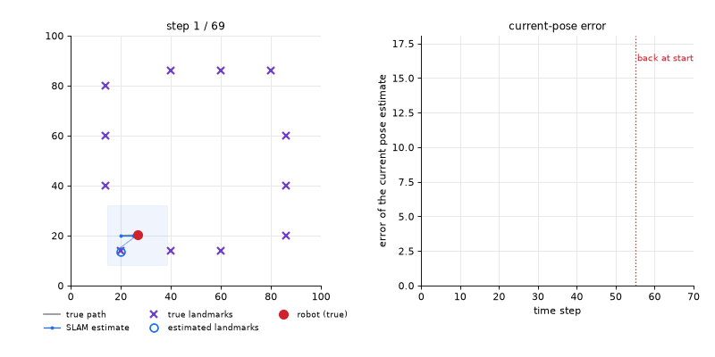
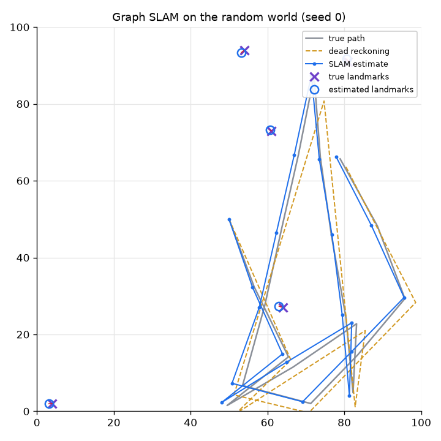
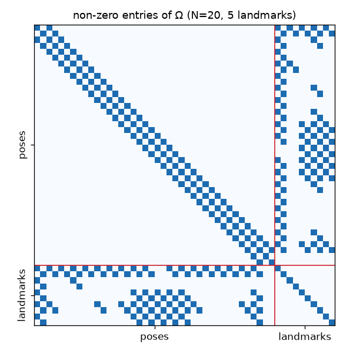
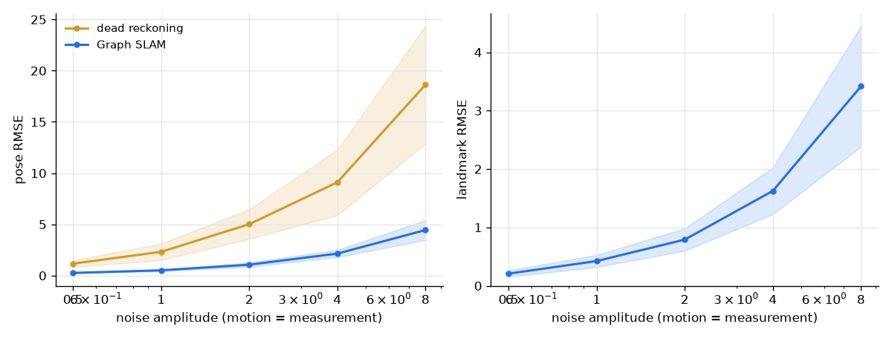
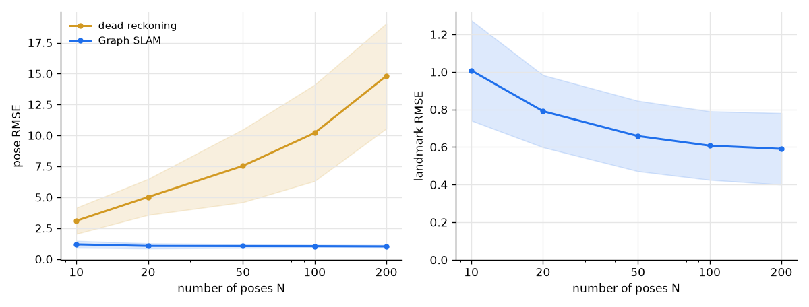
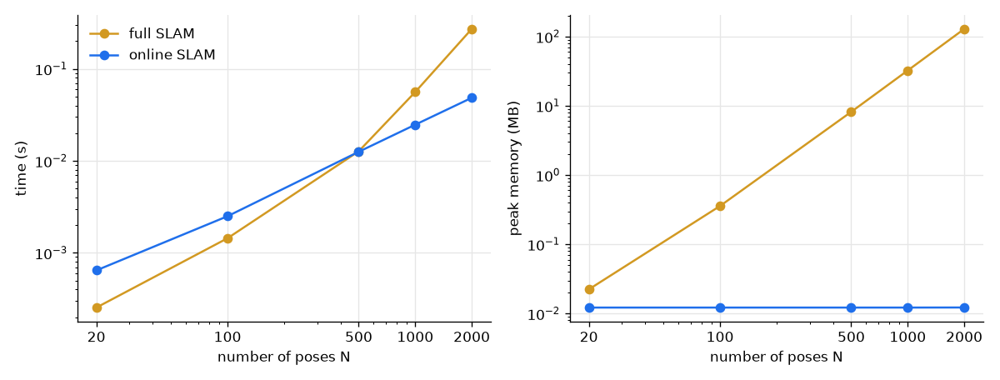
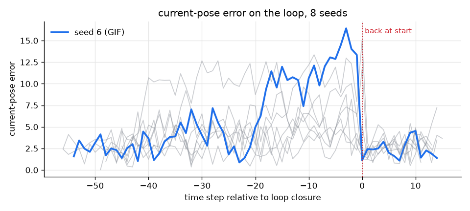

# Graph SLAM in 2D

[](https://github.com/igquinteroch/computer-vision-projects/actions/workflows/graph-slam-tests.yml)

A robot that maps landmarks and localizes itself at the same time, from noisy odometry and noisy landmark measurements. It uses Graph SLAM: one linear system over every pose and every landmark. The project also includes an online variant with constant memory, and an evaluation against ground truth on random and structured worlds.

<p align="center">
  <br>
  <em>Loop closure. Grey: true path. Blue: SLAM estimate, re-solved at every step. Red lines: landmark errors. The current-pose error grows to 13 units during the lap and drops to about 2.5 once the robot re-observes the landmarks next to its start.</em>
</p>

## Overview

The robot only knows what it commanded (move by `(dx, dy)`) and what it measured (the offset to each landmark inside its sensing window). Both are corrupted by noise. Each motion and each measurement becomes a soft linear constraint `b − a = d` with weight `1 / noise`. All of them are accumulated into an information matrix Ω and vector ξ, and the best estimate is μ = Ω⁻¹ξ, computed with `np.linalg.solve`.

| | |
|---|---|
| State | Interleaved `[x0, y0, …, x_{N-1}, y_{N-1}, Lx0, Ly0, …]`, first pose anchored at the known start |
| Motion model | Commanded move + uniform noise in `[-1, 1) × motion_noise` per axis |
| Sensor model | Offset to every landmark inside a square window of half-width `measurement_range`, + uniform noise; data association known |
| Full SLAM | Dense Ω of size `2(N + L)`, solved once (`slam.slam`) |
| Online SLAM | Only the current pose and the landmarks; the previous pose is marginalized with a Schur complement each step (`slam.online_slam`) |
| Evaluation | Ground-truth error of poses and landmarks over 20 seeded runs per setting, with dead reckoning as a baseline |

<p align="center">
  
  <br>
  <em>Left: random world, seed 0. Pose RMSE is 1.44 with SLAM and 3.72 with dead reckoning. Right: Ω is sparse. Motion links consecutive poses, and measurements link poses to landmarks.</em>
</p>

## Results

### Accuracy vs. noise and run length

The random world has 5 landmarks in a 100 × 100 world, a sensing range of 50 and steps of 20 units. Each number is the mean over seeds 0–19. Notebook [`05`](notebooks/05_noise_and_horizon.ipynb) has the per-seed results and [`assets/sweep_results.csv`](assets/sweep_results.csv) has the raw values.

| Noise (motion = meas.) | Final pose error | Pose RMSE | Landmark RMSE | Dead reckoning pose RMSE |
|---|---|---|---|---|
| 0.5 | 0.49 | 0.26 | 0.21 | 1.16 |
| 1 | 0.70 | 0.51 | 0.42 | 2.32 |
| 2 | 1.55 | 1.06 | 0.79 | 5.02 |
| 4 | 3.47 | 2.15 | 1.63 | 9.11 |
| 8 | 6.06 | 4.44 | 3.42 | 18.64 |



Errors scale linearly with the noise, as expected from a linear least-squares estimator. SLAM's pose error is about 4–5 times lower than dead reckoning at every noise level.

| N (noise 2) | Final pose error | Pose RMSE | Landmark RMSE | Dead reckoning pose RMSE |
|---|---|---|---|---|
| 10 | 2.15 | 1.19 | 1.01 | 3.09 |
| 20 | 1.55 | 1.06 | 0.79 | 5.02 |
| 50 | 1.84 | 1.05 | 0.66 | 7.54 |
| 100 | 1.72 | 1.05 | 0.61 | 10.21 |
| 200 | 1.89 | 1.03 | 0.59 | 14.82 |



Longer runs don't make SLAM's pose estimate worse, because every pose is tied to landmarks it can see. Dead reckoning drifts like a random walk. The landmark estimates keep improving with every re-observation, but more slowly as N grows, because they are limited by the error of the poses they are measured from.

### Online SLAM

Marginalizing the previous pose is exact for this linear problem. The final pose and landmarks from online SLAM match full SLAM to between 1e-13 and 1e-11 on the two course test cases, three random runs with N = 200 and the loop run. `tests/test_slam.py` checks this on every push that touches `graph_slam/`.



| N | Full SLAM time | Online SLAM time | Full SLAM peak memory | Online SLAM peak memory |
|---|---|---|---|---|
| 100 | 1.5 ms | 2.5 ms | 0.36 MB | 0.012 MB |
| 500 | 12.6 ms | 12.2 ms | 8.2 MB | 0.012 MB |
| 2000 | 274 ms | 49 ms | 129 MB | 0.012 MB |

Online SLAM uses constant memory and linear time. Full SLAM's dense Ω grows with N². Below a few hundred poses, the dense solve is as fast as or faster than online SLAM's per-step Python loop. Full SLAM keeps the whole trajectory, though, so it can still correct past poses after a loop closure. Times were measured on an Apple M3 Pro and will vary between runs and machines.

### Structured worlds

Notebook [`04`](notebooks/04_structured_worlds.ipynb) uses two structured worlds:

- **Loop.** A square circuit of side 60 with 12 landmarks and a sensing range of 12, so the robot sees at most one landmark at a time. Motion noise is 3 and measurement noise 1. Over 8 seeds:
  - the current-pose error just before returning to the start averages **5.86**, and **2.83** after the closure;
  - full SLAM also corrects the first lap retroactively, with first-lap pose RMSE falling from **4.72 to 2.66**;
  - the effect depends on how much drift built up, from 13.35 → 2.43 in seed 6 (the GIF) to no change in seeds where the lap ended with little error.
- **Corridor.** Two rows of landmarks and an out-and-back path, with a sensing range of 8. The error peaks at the far end and comes back down on the return. Error along the corridor is no larger than across it (1.22 vs 1.02 over 8 seeds). This sensor reports full 2D offsets and data association is known, so every measurement constrains both axes. Real corridors suffer along the axis because of range-only or bearing-only sensing and ambiguous landmarks. Shrinking the range to 4 leaves about 7 of the 18 landmarks unseen and raises pose RMSE from 1.95 to 5.10.



### Course reference test cases

The course provides two recorded runs with expected outputs. This implementation differs from the published values by up to 0.40 (case 1) and 1.29 (case 2) per coordinate. Notebook [`02`](notebooks/02_graph_slam.ipynb) shows that rescaling the weights changes nothing, and that no ratio between measurement and motion weights gets closer than 0.34 / 1.23. The published values most likely come from a different reference implementation or a different copy of the data. The regression tests therefore pin this implementation's own outputs on those runs, and correctness is measured against ground truth on seeded simulations.

### Limitations and next steps

- **Gaussian noise and a circular sensing range.** The uniform noise and square window come from the original course model. They keep the course test cases comparable, but real sensors are closer to Gaussian, and that is the model under which μ = Ω⁻¹ξ is the maximum-likelihood estimate.
- **Sparse solver.** Ω stays sparse, so `scipy.sparse` (or a banded Cholesky factorization) would make full SLAM close to linear in N.
- **Unknown data association.** Matching measurements to landmarks would bring in the corridor aliasing that this model avoids.
- **Nonlinear models.** Range–bearing measurements and a heading state would need iterative linearization (Gauss–Newton), as in real pose-graph SLAM.

## Project structure

```
graph_slam/
├── robot.py                # Robot: noisy move() and sense(), seeded RNG
├── world.py                # random / corridor / loop worlds; simulate_* return data + ground truth
├── slam.py                 # constraints, full SLAM, slam_observed (prefixes), online SLAM
├── metrics.py              # final-pose error, RMSE, dead reckoning, seeded sweeps
├── viz.py                  # world plots, Ω sparsity, sweep figures, GIF animation
├── data/
│   └── udacity_test_cases.py   # the two course test runs and their published outputs
├── tests/test_slam.py      # regression on the course runs + online == full
├── notebooks/
│   ├── 01_robot_and_sensing.ipynb
│   ├── 02_graph_slam.ipynb
│   ├── 03_online_slam.ipynb
│   ├── 04_structured_worlds.ipynb
│   └── 05_noise_and_horizon.ipynb
├── scripts/
│   ├── make_gif.py         # regenerates assets/slam_loop.gif
│   └── run_sweeps.py       # regenerates the sweep CSV and figures
└── assets/                 # figures used in this README
```

## How to run

**1. Environment** (Python 3.11):

```bash
cd graph_slam
uv venv --python 3.11 .venv && source .venv/bin/activate   # or: python -m venv .venv
uv pip install -r requirements.txt                          # or: pip install -r requirements.txt
```

**2. Tests:**

```bash
pytest -v
```

**3. Notebooks.** Run them from the `notebooks/` directory. Each one runs on CPU in a few seconds and needs no data downloads.

| Notebook | What it does |
|---|---|
| `01_robot_and_sensing` | Motion and sensor model, a full simulated run, dead reckoning |
| `02_graph_slam` | Constraints, Ω structure, SLAM on a random world, error analysis, course test cases |
| `03_online_slam` | Online SLAM, verification against full SLAM, time and memory |
| `04_structured_worlds` | Corridor and loop worlds, loop closure over 8 seeds |
| `05_noise_and_horizon` | Error vs. noise and vs. N, 20 seeds each |

To regenerate the GIF and the sweep figures, run `python scripts/make_gif.py` and `python scripts/run_sweeps.py`.

## Credits

- This project started as the Graph SLAM project of the Udacity Computer Vision Nanodegree. Based on the course code:
  - the `Robot` class (`robot.py`), including its move/sense interface and uniform noise model;
  - the random-world motion policy in `world.simulate_random` (straight line, new random heading at the walls, retry until every landmark is seen);
  - the two reference test runs and their expected outputs in `data/udacity_test_cases.py`;
  - the interleaved state layout and the `[measurements, [dx, dy]]` data format.
- My own work:
  - the `sense()` and SLAM implementations;
  - the online SLAM with Schur-complement marginalization;
  - the corridor and loop worlds, the ground-truth evaluation and sweeps, the analysis of the test-case discrepancy;
  - the visualizations, the tests and the refactor into modules.
- S. Thrun, M. Montemerlo. [*The GraphSLAM Algorithm with Applications to Large-Scale Mapping of Urban Structures*](https://doi.org/10.1177/0278364906065387). IJRR 2006.
- S. Thrun, W. Burgard, D. Fox. *Probabilistic Robotics*, ch. 11 (GraphSLAM). MIT Press, 2005.
