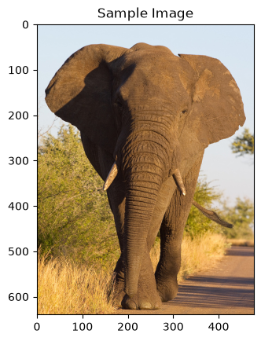
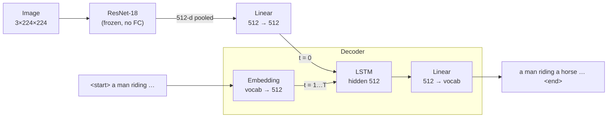
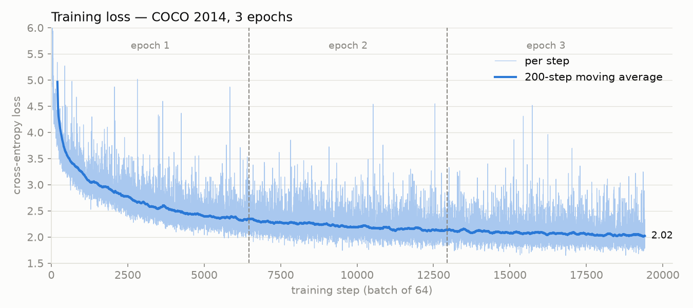
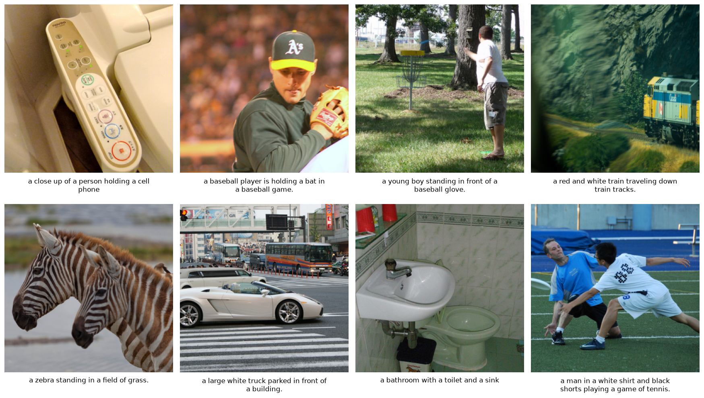
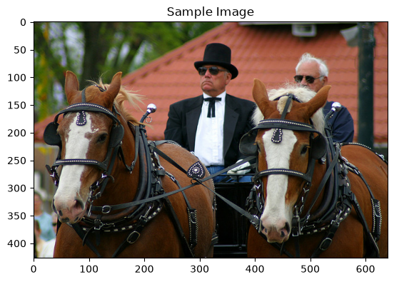
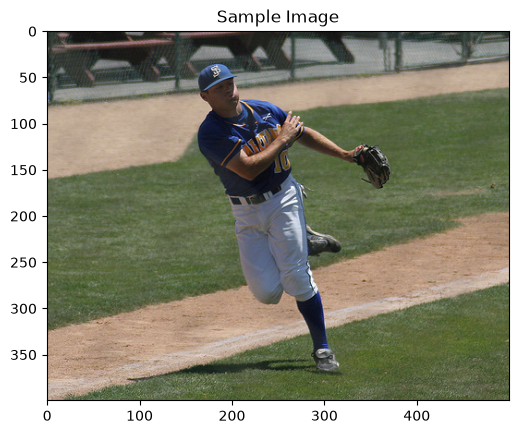
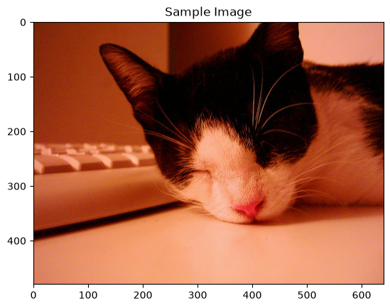
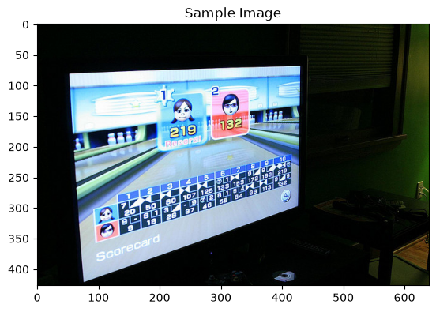

# Image Captioning with a CNN-RNN

A ResNet-18 encoder and an LSTM decoder, trained on MS COCO 2014, that generate a one-sentence description of an image.

<p align="center">
  <br>
  <em>"a large elephant standing in a field next to a tree."</em>
</p>

## Overview

The model follows the *Show and Tell* approach (Vinyals et al., 2015). A convolutional network compresses the image into a single embedding vector. An LSTM language model takes that vector as its first input and generates the caption one word at a time. Training used all 414k image–caption pairs in COCO train2014 for 3 epochs.

| | |
|---|---|
| Encoder | ResNet-18 (ImageNet, frozen) + trainable linear projection to 512-d |
| Decoder | Word embedding (512) → 1-layer LSTM (512) → linear over the 9,949-token vocabulary |
| Training | Cross-entropy with teacher forcing, Adam (lr 1e-3), 64 images × 4-step gradient accumulation (effective batch 256), 3 epochs |
| Decoding | Greedy, up to 20 tokens |
| Final loss | ≈ 2.0 (200-step moving average, perplexity ≈ 7.5) |
| Hardware | Apple M3 Pro (MPS), ~3 h for 3 epochs |

## Architecture



- **Image as the first time step.** The projected image embedding goes into the LSTM before any word. Later steps receive caption tokens: the ground truth during training (teacher forcing), and the previous prediction at inference time.
- **Frozen backbone.** Only the projection layer and the decoder are trained. This keeps the ImageNet features and makes each training step cheap.
- **Batches grouped by caption length.** Every caption in a batch has the same length, which is sampled in proportion to how often it occurs. As a result no padding or masking is needed.

The reasoning behind each choice is in the *Design decisions* section of [`02_training`](notebooks/02_training.ipynb).

## Results

Training loss drops quickly in the first few hundred steps, as the decoder learns the basic structure of a caption, and then keeps falling slowly. The 200-step moving average is ≈2.35 at the end of epoch 1, ≈2.14 after epoch 2 and ≈2.02 at the end of training. The step-to-step noise comes from batches having different caption lengths.



### Random samples (not cherry-picked)

Eight test2014 images drawn with a fixed seed (`random.Random(42)`) and captioned with greedy decoding. The grid is generated in [`03_inference`](notebooks/03_inference.ipynb).



### Captions that work

| | |
|---|---|
|  |  |
| *"a man in a hat and a brown horse"* | *"a large elephant standing in a field next to a tree."* |

The model gets the main subjects and their attributes right (top hat, brown horses, elephant), and the setting is plausible. These captions also show its limits. The carriage caption has no verb and uses the singular for what are actually two men and two horses. The elephant is in fact walking along a dirt road, but the model falls back on the most common COCO phrasing.

### Captions that fail

| | | |
|---|---|---|
|  |  |  |
| *"a baseball player is swinging at a ball."* | *"a cat is sitting on a chair with a cat."* | *"a man standing next to a computer on a desk."* |

- **Baseball:** the player is a fielder making a throw, and no bat is visible. The model recognizes the scene but takes the action from the dataset prior, since "swinging at a ball" dominates COCO's baseball captions.
- **Cat:** one cat is asleep with its head on a desk next to a keyboard. The model chooses the wrong furniture and repeats the subject, which is a typical greedy-decoding failure when there is no attention or coverage mechanism.
- **Screen:** the image is a TV showing a bowling video game scoreboard. The model maps the cartoon avatars to "man" and the screen to "computer". It has no notion of *content shown on a screen*.

The full analysis is in [`03_inference`](notebooks/03_inference.ipynb).

### Limitations and next steps

- Beam search instead of greedy decoding, to get more grammatical captions with fewer repetitions.
- Quantitative evaluation (BLEU-4, METEOR, CIDEr) on a held-out COCO val2014 split.
- Spatial attention over the ResNet feature map (*Show, Attend and Tell*), which should help with counting, pose and small objects.
- Fine-tuning the last ResNet block once the decoder has converged.

## Project structure

```
image_captioning/
├── config.py            # paths, device (cuda → mps → cpu), final hyperparameters
├── model.py             # EncoderCNN, DecoderRNN, load_trained()
├── data_loader.py       # COCO dataset + length-bucketed batch sampling
├── vocabulary.py        # token ↔ id mapping
├── vocab.pkl            # vocabulary used by the released weights (threshold 4)
├── training_log.txt     # per-step loss/perplexity of the training run
├── notebooks/
│   ├── 01_data_exploration.ipynb
│   ├── 02_training.ipynb
│   └── 03_inference.ipynb
├── scripts/plot_loss.py # regenerates assets/loss_curve.png
└── assets/              # figures used in this README
```

## How to run

**1. Environment** (Python 3.11):

```bash
cd image_captioning
python -m venv .venv && source .venv/bin/activate
pip install -r requirements.txt
```

**2. Pretrained weights.** Download them from the [GitHub release](https://github.com/igquinteroch/computer-vision-projects/releases/tag/image-captioning-v1.0) and put them in `models/`:

```bash
mkdir -p models
curl -L -o models/encoder-3.pkl https://github.com/igquinteroch/computer-vision-projects/releases/download/image-captioning-v1.0/encoder-3.pkl
curl -L -o models/decoder-3.pkl https://github.com/igquinteroch/computer-vision-projects/releases/download/image-captioning-v1.0/decoder-3.pkl
```

**3. COCO 2014.** Download the [annotations](http://images.cocodataset.org/annotations/annotations_trainval2014.zip), the [test image info](http://images.cocodataset.org/annotations/image_info_test2014.zip), and the [train](http://images.cocodataset.org/zips/train2014.zip) and [test](http://images.cocodataset.org/zips/test2014.zip) images (~19 GB together), and arrange them like this:

```
data/cocoapi/
├── annotations/   # captions_train2014.json, image_info_test2014.json, ...
└── images/
    ├── train2014/
    └── test2014/
```

`data/` is the default location. To use a dataset stored elsewhere, point `COCO_ROOT` at the directory that contains `cocoapi/`:

```bash
export COCO_ROOT=/path/to/coco
```

For inference only, the test images (~6 GB) and `image_info_test2014.json` are enough; you can skip train2014.

**4. Notebooks.** Run them from the `notebooks/` directory:

| Notebook | What it does | Needs |
|---|---|---|
| `01_data_exploration` | Captions, tokenization, vocabulary threshold, length-bucketed batches | train2014 + captions |
| `02_training` | Trains the model; overwrites `training_log.txt` and `models/` | train2014 + captions, a GPU (CUDA or Apple Silicon) |
| `03_inference` | Loads the weights and captions test images | test2014, weights |

To regenerate the loss curve, run `python scripts/plot_loss.py`.

## Credits

- The starter code (`data_loader.py`, `vocabulary.py`, and the notebook skeletons) comes from the Udacity Computer Vision Nanodegree. The encoder is adapted from the starter code. The decoder, the training configuration and the analysis are my own work.
- O. Vinyals, A. Toshev, S. Bengio, D. Erhan. [*Show and Tell: A Neural Image Caption Generator*](https://arxiv.org/abs/1411.4555). CVPR 2015.
- K. Xu et al. [*Show, Attend and Tell*](https://arxiv.org/abs/1502.03044). ICML 2015. The length-bucketed batching follows this paper.
- T.-Y. Lin et al. [*Microsoft COCO: Common Objects in Context*](https://arxiv.org/abs/1405.0312). ECCV 2014.
